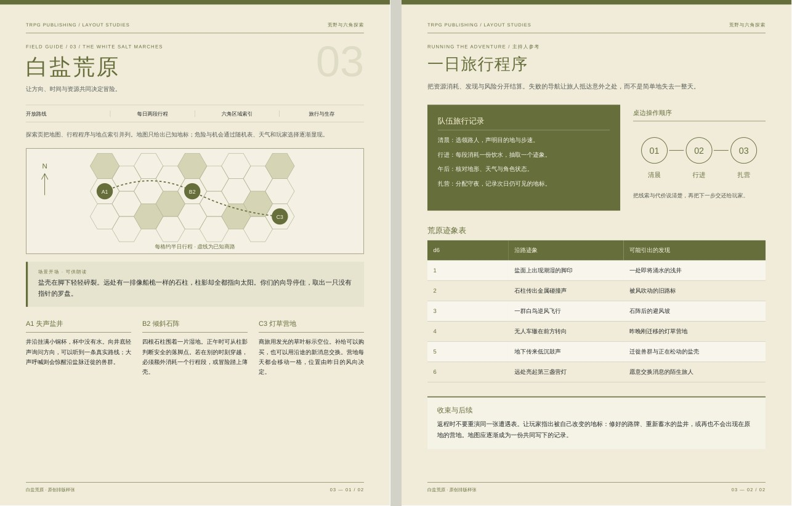

# trpg-publishing-skills

面向 Codex、Claude Code 等 AI Agent 的 TRPG 中文 PDF 排版 Skill。用户自行提供有权使用的英文原版 PDF、中文 Markdown 译稿和字体，通过 Python、PyMuPDF、Vivliostyle 与 Chromium，生成保留原版视觉语言的中文 PDF，以及可审阅的语义源、HTML、书签和 QA 报告。

本仓库提炼自已有长篇模组的实际构建管线，已移除具体书籍的 PDF、译文、美术、地图、封面、字体和成品。这里提供的是可适配的工具与流程；新书的字体角色、章节范围、美术资源和统计块仍需人工或 Agent 核对。

## 功能范围

- 盘点原版字体、字号、颜色和图像；按配置提取英文版式角色。
- 逐章解析中文译稿，以数字、区域编号和拉丁词锚点对齐原版，生成语义 Markdown。
- 处理朗读框、侧栏、统计块、讲义、表格、插图和图注；不润色或重新翻译正文。
- 提取带透明蒙版的图片，裁切地图并按词表替换标签，按配置合成页框和去文字章首。
- 双栏排版、章节扉页、作者和译者署名、章内目录、全书目录、奇偶衬页、PDF 书签与元数据。
- 串行逐章编译；检查内容覆盖、底部溢出、章节奇偶、书签、字体、页码标签和渲染警告。

默认模板使用无素材的纸色背景。贴近原版的边框、扉页、地图和纹理必须从用户有权使用的原版中配置；不会自动判断版权或自动猜出一本书的版式。

## 架构与目录

```text
trpg-publishing-skills/
├── AGENTS.md                    # 仓库级 Agent 指引
├── skills/trpg-zh-typesetting/
│   ├── SKILL.md                  # Agent 入口
│   ├── agents/openai.yaml        # Codex / 支持该格式的界面元数据
│   ├── references/               # 环境、管线、适配、设计、图注与 QA
│   ├── tools/                    # 初始化模组、盘点 PDF、字体准备
│   └── templates/                # Python 脚本、CSS、JSON、Vivliostyle 配置
├── docs/                        # 架构、工作流、定制、排障、验证记录
├── examples/minimal/            # 原创占位文字和 PDF 生成器，无二进制
├── tests/                       # 无浏览器、无商业素材的集成与回归检查
├── tools/                       # 环境检查、初始化与仓库结构检查
├── pyproject.toml               # Python 项目及准确的直接依赖
├── requirements.txt             # 固定直接和传递依赖的版本快照
├── package.json
├── package-lock.json            # 源项目真实 npm 锁，未重新生成
├── .env.example
└── .gitignore
```

本地运行后另有 fonts/、modules/<name>/、local/（全部忽略）。模块包含 input/、scripts/、src/{config,chapters,styles,front}/、assets/、build/、work/、output/。

数据流是“英文 PDF → 角色和素材；译稿 + 角色 → 语义 Markdown → HTML/CSS → Vivliostyle/Chromium → 章节 PDF → PyMuPDF 合并与 QA”。详见 [架构](docs/architecture.md)。

## 系统要求

- 推荐 Linux 或 WSL，Bash；约 8 GB 内存，Vivliostyle 逐章串行。
- Python ≥3.12，排除 3.14.1（当前固定 networkx 版本的声明）；验证环境使用 Python 3.13。
- Node.js ≥22.12、npm；Vivliostyle 11.4.0 的要求来自真实锁文件。推荐受支持的较新 Node 版本。
- 自行安装的 Chrome 或 Chromium。浏览器路径通过 VIVLIOSTYLE_BROWSER 配置。
- 自行提供可合法使用的中文字体；推荐静态 glyf TrueType。仓库不附字体。
- 可选 Poppler 的 pdfinfo/pdffonts；Git 用于版本管理。

脚本主要面向 Linux/WSL。Windows 原生环境需要处理 Python、字体相对链接和浏览器路径；不将 WSL 的 .venv 与 Windows 可执行程序混用。

## 安装依赖

下面命令由用户明确执行，会安装依赖；Agent 不应自动安装。先进入本仓库根目录：

```bash
bash tools/init_env.sh
python3.13 -m venv .venv
.venv/bin/python -m pip install -r requirements.txt
PUPPETEER_SKIP_DOWNLOAD=1 PLAYWRIGHT_SKIP_BROWSER_DOWNLOAD=1 npm ci
```

init_env.sh 只建立目录及缺失的 .env。pyproject.toml 的直接依赖为 PyMuPDF、Pillow、NumPy、fontTools、PyYAML，requirements.txt 同时固定当前快照中的传递依赖。该快照来自本地已安装包元数据及源项目记录，不冒充带哈希的解析器锁；尚未在全新联网环境验证全部安装。未提供虚构 uv.lock。不同平台的 wheel、Python ABI 和系统库仍需实际验证。

Node 的两个依赖文件逐字节保留源 shared/tools 版本，npm ci 按锁安装；原 package.json 的名称、默认 test 命令和 ISC 字段是原始元数据，不代表整个仓库的授权，验证也不用 npm test。

编辑 .env，设置本机浏览器，然后显式载入：
```bash
set -a
source .env
set +a
.venv/bin/python tools/check_env.py
```
脚本不会自动载入 .env。支持 NODE、VIVLIOSTYLE_CLI、TRPG_TOOLS_ROOT 等覆盖项，见 [.env.example](.env.example) 与 [环境参考](skills/trpg-zh-typesetting/references/environment.md)。依赖不完整时检查返回非零，不自动安装。

## 字体准备

从合法来源自行取得下列字体，放在被忽略的 fonts/：

```text
NotoSerifSC-VF.ttf       NotoSansSC-VF.ttf
LXGWWenKai-Regular.ttf  LXGWWenKai-Medium.ttf
Cinzel.ttf             CinzelDecorative-Bold.ttf
```

Noto 和 Cinzel 的前述输入应为变量 TrueType；CinzelDecorative-Bold 为静态字体。输入名需与工具约定一致。执行：
```bash
.venv/bin/python skills/trpg-zh-typesetting/tools/font_prep.py instances
```
生成独立字重的静态字体。初始化模组会建立相对字体链接；完成章节、图注、署名配置后，再为每本书生成自己的文楷子集：
```bash
.venv/bin/python skills/trpg-zh-typesetting/tools/font_prep.py subset modules/my-book
```
新增文字后重做子集。自定义字体需同步修改模块 CSS；验证成品不能有 Type3 或缺字。本次未运行真实字体准备，详见 [验证记录](docs/validation.md)。

## 快速开始：用户书籍

1. 原版和译稿保存在仓库外或被忽略的 local/。译稿按章命名：001-intro.md、002-next.md。输入必须有使用权限。
2. 初始化：
```bash
.venv/bin/python skills/trpg-zh-typesetting/tools/new_module.py my-book /absolute/original.pdf /absolute/translations
```
目标模块已存在则拒绝；输入只复制，副本设为只读。可用 --root /other/workspace 改变 modules 的父目录。书籍配置和模块脚本是本地工作文件，不提交到本 Skill 仓库。
3. 在 modules/my-book 配置 src/config/，详见 [定制指南](docs/customization.md)。默认章节范围只是 [1,1] 占位，不能直接用于真实书籍。先盘点原版并确认行号、字体、美术与开本。
4. 准备字体并运行以下构建和 QA。

## 输入格式

- 原版：可由 PyMuPDF 读取、带文本层的英文 PDF。pages 使用 PDF 物理页码，1 起；加密、扫描件或无文本层输入需要事先处理，本管线不包含 OCR。
- 译稿：UTF-8 Markdown，章号从 001 连续且唯一；一个文件对应一章，文件名以三位数字开头。普通段落、标题、粗斜体、列表、管道表格及有限的 HTML div/table 可解析；不是完整 CommonMark 实现。
- 配置：book.json（书籍与开本）、chapters.json（章节与行号）、roles.json（英文角色规则）、art.json（美术）、maps.json、caption_glossary.json。
- 译者附加目录、导航等只有确认不是正文后才写入 drop；所有排除项和重复标题保留审查记录。疑似误译、笔误记报告，正文不改措辞。
- Markdown 中的原始 HTML 视为可信的本地输入；不要处理不信任的主动内容。

## 构建命令

从模块目录执行，以下 P 使用实际解释器绝对路径：
```bash
cd modules/my-book
P="$(realpath ../../.venv/bin/python)"
"$P" scripts/build.py --prep
"$P" scripts/build.py
"$P" scripts/build.py --only 1
```
--prep 按配置执行英文与图片提取、美术、地图、插图、图注、规范化、HTML、编译和合并。只改 CSS 可直接 build.py；--only 复用其他章节，缺失或起始页改变时仍会补编。首次样章可先只配置第一章，确认设计后再加入其他章节。

最终文件名由 book.json 的 output 决定，默认 output/final/book-zh.pdf。中间 work/pdf/state.json 记录章节起始页、页数和目录。全书至少完整构建两次，并比较状态确认目录收敛；不要把最后一次 --only 当全书验收。

## QA 验证

```bash
"$P" scripts/qa_content.py --pdf
"$P" scripts/qa_overflow.py
"$P" scripts/qa_structure.py
"$P" scripts/report_art.py
"$P" scripts/sheet.py output/final/book-zh.pdf output/preview/sheet.jpg 1 40 8 230
pdffonts output/final/book-zh.pdf
```

内容低于门槛、溢出或结构硬错误返回非零；低文字量页列出供人工检查。语义覆盖 ≥99.9%、PDF 覆盖 ≥99.7% 只是筛查线，每条未命中和 drop 都需解释。实际查看全书联系表和可疑页，核对地图、统计块、目录、书签、字体、缺字、章首奇偶和空白页。详见 [QA 参考](skills/trpg-zh-typesetting/references/qa.md)。

仓库验证命令：
```bash
.venv/bin/python tools/validate_repository.py
.venv/bin/python -m unittest discover -s tests -v
```
测试用临时目录生成原创 PDF，检查初始化拒绝覆盖、只读输入、角色提取、语义源、美术、HTML、署名及 QA 正反例，不需要商业模组或浏览器。它不替代真实 Chromium 排版验证。

## 原创最小示例

```bash
.venv/bin/python examples/minimal/create_demo.py
```
仅用仓库中原创占位文本和程序绘图，在 local/demo-input 与 modules/demo 生成本地测试输入和配置；目标已存在则拒绝。准备字体后，在 modules/demo 执行上述完整构建命令。也可 --root /tmp/my-trpg-demo 生成到独立目录。示例生成的 PDF、图片、译稿副本和输出不会提交。

## 排版成品样张

[打开离线画廊](examples/layout-gallery/index.html) · [下载 12 页合订本](examples/layout-gallery/pdf/trpg-layout-collection.pdf) · [源码与重建说明](examples/layout-gallery/README.md)

提供六套两页成品，覆盖线性章节、线索调查、荒野六角探索、编号地城、城市派系与长篇战役。每套包含独立 PDF 和双页预览，展示朗读框、节点图、原创地图、场景威胁、随机表、派系时钟及跨章导航。全部正文与图形均为原创、系统中立的排版示例；不复刻任何商业模组的美术。



这些成品通过独立的画廊构建脚本生成，适合选版式与比较信息结构。它们不替代真实模组的提取、对齐和完整 QA，也不改变通用模块模板。仓库仅为这组原创成品放行 PDF/JPG，用户书籍与其他生成物仍被忽略。

## 使用 Codex 或 Claude Code

保留整个仓库。最稳妥的方式是在 Agent 中明确给出 Skill 的绝对路径，并要求先读取 SKILL.md 和引用文档。无需复制素材到 Skill 安装目录。

Codex 的项目级目录可链接 Skill（在你的工作项目根执行；已有同名目录时不要覆盖）：
```bash
mkdir -p .agents/skills
ln -s /absolute/trpg-publishing-skills/skills/trpg-zh-typesetting .agents/skills/trpg-zh-typesetting
```
支持 Skill 的 Codex 环境可显式调用 $trpg-zh-typesetting。Claude Code 可在自己的项目 .claude/skills/ 下建立同样的链接，或直接要求读取绝对路径。不同客户端的自动发现方式可能不同，直接读文件的方式不依赖自动发现。

提示词示例：
> 请使用 $trpg-zh-typesetting，先读取 /absolute/trpg-publishing-skills/skills/trpg-zh-typesetting/SKILL.md。英文 PDF 在……，逐章译稿在……。先盘点并配置样章，不改译文措辞，不自动安装依赖；样章核对后构建全书并输出实际 QA 结果。

agents/openai.yaml 提供显示名、简介和默认调用提示，供 Codex 及读取该格式的 ChatGPT/Agent 界面使用。它不是 ChatGPT 网页中的安装插件；普通纯聊天环境没有本地文件、Python、Node 和浏览器执行权限时，无法仅凭上传该 YAML 完成构建，需要具备这些执行能力的工作环境。

## 已知限制

- 不是任意模组的一键自动复刻。角色映射、美术身份、地图标签和版式须逐书适配。
- 统计块识别偏 PF1；其他规则系统要改模块副本中的术语与分组规则。
- 对齐、图注就近匹配、书签搜索和美术成书页定位均为启发式，可能误判。
- 修改开本不会自动缩放扉页绝对坐标；QA 不覆盖所有横向溢出、图像重叠和视觉问题。
- 字体和浏览器版本会影响分页；目录可能需要多次完整构建。
- 已使用现有 Chromium 和系统测试字体编译原创样章；未验证全新联网安装、真实字体实例化及推荐字体组合，本次检查的具体边界见 [验证记录](docs/validation.md)。
- 输出是否可印刷还需人工检查；不包含 PDF/X、CMYK 分色、出血或印厂验收保证。

## 版权与授权

用户必须自行取得英文原版、中文译稿、美术与字体的使用及再分发权限。购买 PDF 不自动取得翻译或公开发布成书的授权。本仓库不包含这些内容，也不授予这些权利。

源项目未发现覆盖整个代码与文档的明确许可证，因此这里不擅自声明 MIT、ISC 等整体授权，也不添加推测的 LICENSE。原 Node package.json / 锁文件保留的 ISC 字段只是源工具清单原样元数据，不能据此认定所有代码已获 ISC 授权。当前代码公开再分发的许可状态仍待权利人确认；首次本地提交不等于公开授权已经解决。各第三方依赖另受其许可证约束，发布或商业使用前应核实相应条款。

[贡献约定](CONTRIBUTING.md) · [工作流](docs/workflow.md) · [定制](docs/customization.md) · [排障](docs/troubleshooting.md)
